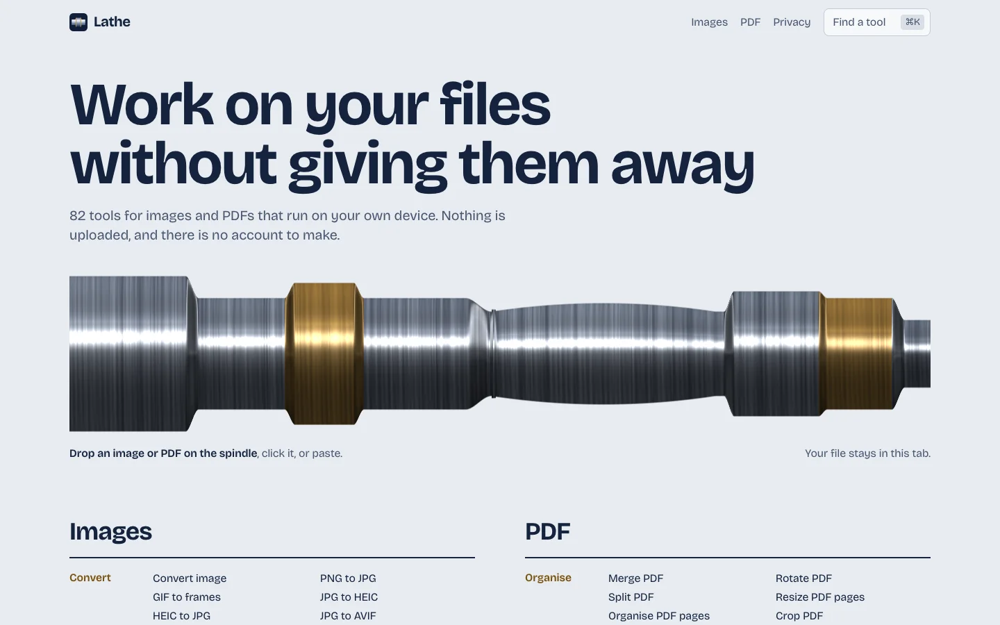
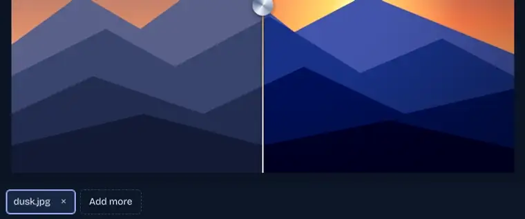
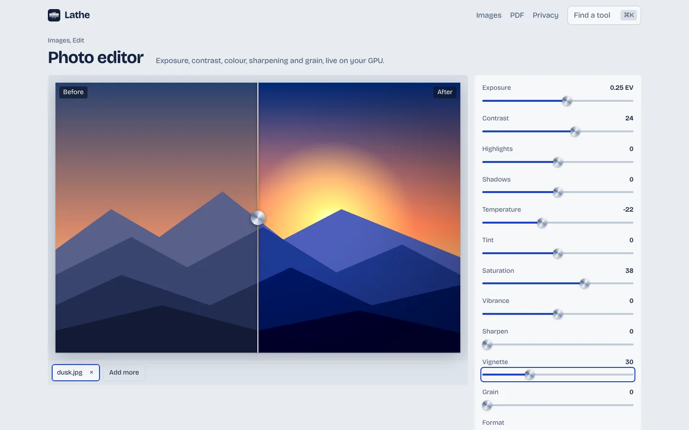

<div align="center">

<picture>
  <source media="(prefers-color-scheme: dark)" srcset="docs/images/home-dark.webp">
  
</picture>

# Lathe

**Image and PDF tools that run entirely in your browser. Your files are never uploaded.**

[Open Lathe](https://lathe.ashwinsathian.com) · [Documentation](https://lathe.ashwinsathian.com/docs) · [All tools](docs/tools.md) · [Verify privacy](docs/verify-privacy.md) · [Self-host](docs/self-hosting.md)

[](https://github.com/AshwinSathian/lathe/actions/workflows/ci.yml)
[](https://github.com/AshwinSathian/lathe/actions/workflows/codeql.yml)
[](https://scorecard.dev/viewer/?uri=github.com/AshwinSathian/lathe)
[](LICENSE)

</div>

Most free PDF and image sites work by uploading your passport scan, contract or family photo to their server. Lathe does the work on your own device with WebAssembly, WebGL, WebGPU and WebCodecs. There is no account, watermark or backend.



## What it can do

<!-- tools:start (generated by npm run docs) -->
**82 tool pages:** 60 tools and 22 one-click format conversions such as [HEIC to JPG](https://lathe.ashwinsathian.com/heic-to-jpg).

| Images | |
|---|---|
| Convert | [Convert image](https://lathe.ashwinsathian.com/convert-image), [GIF to frames](https://lathe.ashwinsathian.com/gif-to-frames) |
| Optimise | [Compress image](https://lathe.ashwinsathian.com/compress-image), [Optimise SVG](https://lathe.ashwinsathian.com/optimize-svg) |
| Edit | [Resize image](https://lathe.ashwinsathian.com/resize-image), [Crop image](https://lathe.ashwinsathian.com/crop-image), [Rotate and flip image](https://lathe.ashwinsathian.com/rotate-image), [Photo editor](https://lathe.ashwinsathian.com/adjust-image), [Photo filters](https://lathe.ashwinsathian.com/filter-image), [Watermark image](https://lathe.ashwinsathian.com/watermark-image), [Add border and shadow](https://lathe.ashwinsathian.com/frame-image), [Social media image sizes](https://lathe.ashwinsathian.com/social-resize) |
| AI | [Remove background](https://lathe.ashwinsathian.com/remove-background), [AI image upscaler](https://lathe.ashwinsathian.com/upscale-image), [Image to text (OCR)](https://lathe.ashwinsathian.com/ocr-image) |
| Privacy | [Remove image metadata](https://lathe.ashwinsathian.com/remove-metadata), [Image metadata viewer](https://lathe.ashwinsathian.com/view-metadata), [Blur faces](https://lathe.ashwinsathian.com/blur-faces), [Pixelate image](https://lathe.ashwinsathian.com/censor-image) |
| Create | [Favicon generator](https://lathe.ashwinsathian.com/favicon-generator), [Colour palette extractor](https://lathe.ashwinsathian.com/color-palette), [Image to SVG](https://lathe.ashwinsathian.com/vectorize-image), [Image to Base64](https://lathe.ashwinsathian.com/image-to-base64), [GIF maker](https://lathe.ashwinsathian.com/make-gif), [Photo collage](https://lathe.ashwinsathian.com/collage), [Split image into grid](https://lathe.ashwinsathian.com/split-image), [Sprite sheet maker](https://lathe.ashwinsathian.com/sprite-sheet), [Compare images](https://lathe.ashwinsathian.com/compare-images), [Colour blindness simulator](https://lathe.ashwinsathian.com/color-blindness) |

| PDF | |
|---|---|
| Organise | [Merge PDF](https://lathe.ashwinsathian.com/merge-pdf), [Split PDF](https://lathe.ashwinsathian.com/split-pdf), [Organise PDF pages](https://lathe.ashwinsathian.com/organize-pdf), [Extract PDF pages](https://lathe.ashwinsathian.com/extract-pages), [Delete PDF pages](https://lathe.ashwinsathian.com/delete-pages), [Rotate PDF](https://lathe.ashwinsathian.com/rotate-pdf), [Resize PDF pages](https://lathe.ashwinsathian.com/resize-pdf), [Crop PDF](https://lathe.ashwinsathian.com/crop-pdf), [N-up PDF](https://lathe.ashwinsathian.com/n-up-pdf), [PDF booklet maker](https://lathe.ashwinsathian.com/booklet-pdf) |
| Optimise | [Compress PDF](https://lathe.ashwinsathian.com/compress-pdf), [Fast web view PDF](https://lathe.ashwinsathian.com/linearize-pdf), [Repair PDF](https://lathe.ashwinsathian.com/repair-pdf), [PDF to grayscale](https://lathe.ashwinsathian.com/grayscale-pdf), [Flatten PDF](https://lathe.ashwinsathian.com/flatten-pdf) |
| Security | [Password protect PDF](https://lathe.ashwinsathian.com/protect-pdf), [Unlock PDF](https://lathe.ashwinsathian.com/unlock-pdf), [Redact PDF](https://lathe.ashwinsathian.com/redact-pdf), [Edit PDF metadata](https://lathe.ashwinsathian.com/pdf-metadata) |
| Annotate | [Sign PDF](https://lathe.ashwinsathian.com/sign-pdf), [Fill PDF form](https://lathe.ashwinsathian.com/fill-pdf), [Watermark PDF](https://lathe.ashwinsathian.com/watermark-pdf), [Add page numbers](https://lathe.ashwinsathian.com/page-numbers) |
| Convert | [Images to PDF](https://lathe.ashwinsathian.com/images-to-pdf), [PDF to images](https://lathe.ashwinsathian.com/pdf-to-images), [PDF to text](https://lathe.ashwinsathian.com/pdf-to-text), [Extract images from PDF](https://lathe.ashwinsathian.com/extract-images), [OCR PDF](https://lathe.ashwinsathian.com/ocr-pdf), [Markdown to PDF](https://lathe.ashwinsathian.com/markdown-to-pdf) |
| Inspect | [Compare PDFs](https://lathe.ashwinsathian.com/compare-pdf), [PDF inspector](https://lathe.ashwinsathian.com/inspect-pdf) |
<!-- tools:end -->

## What makes it different

- **HEIC both ways.** Chrome and Firefox can't open iPhone photos on their own, so Lathe decodes them with libheif in WebAssembly. Export uses your browser's HEVC encoder and a [HEIF writer in this repository](src/engine/heif.ts), so no GPL encoder ships.
- **Redaction that removes the content.** Every page is rebuilt from pixels by default, and tests confirm the hidden text can no longer be extracted.
- **PDF compression that keeps text as text.** It recompresses the embedded images with MozJPEG and rewrites the file with qpdf.
- **AI on your device.** Background removal, upscaling, OCR and face blur run locally. A model downloads only after you agree, and is then cached.
- **Live editing.** Photo adjustments run in a WebGL2 shader, with a before and after divider on the image.
- **Tools that chain.** Send a result straight to the next tool: compress, then protect, then sign.

<picture>
  <source media="(prefers-color-scheme: dark)" srcset="docs/images/editor-dark.webp">
  
</picture>

## Limits

- Removing a PDF password requires that password. Lathe doesn't crack files.
- HEIC export needs a browser with an HEVC encoder. It is tested in Safari's engine on macOS.
- Without WebGPU, background removal uses a smaller model built for portraits.
- Sign PDF adds a visual signature, not a certificate-based one.
- PDF to Word and Excel are left out, because client-side results are poor.
- Remove background and Upscale image download their model from Hugging Face and jsDelivr, checked against pinned hashes. Those services see the download request and nothing from your files. OCR and face blur use files served by this site.

[Browser support](docs/browser-support.md) lists what has been tested where.

## How it compares

[Stirling-PDF](https://github.com/Stirling-Tools/Stirling-PDF) is an open-core PDF platform with desktop, browser and self-hosted server versions and a REST API. Pick it if your team wants a shared server. [BentoPDF](https://github.com/alam00000/bentopdf) is a client-side PDF toolkit under AGPL-3.0 with a commercial option. Lathe covers images as well as PDFs, adds on-device AI, and is MIT licensed. See the [full comparison](docs/compare.md).

## Run it yourself

```bash
docker build -t lathe .
docker run --rm -p 8080:8080 lathe
```

Or develop locally with Node 24:

```bash
npm ci
npm run dev
```

See [self-hosting](docs/self-hosting.md) for Cloudflare, static hosts and air-gapped networks.

## Built with

[Astro](https://astro.build), [jSquash](https://github.com/jamsinclair/jSquash), [libheif](https://github.com/strukturag/libheif), [PDF.js](https://github.com/mozilla/pdf.js), [pdf-lib](https://github.com/Hopding/pdf-lib), [qpdf](https://github.com/qpdf/qpdf), [Tesseract.js](https://github.com/naptha/tesseract.js), [Transformers.js](https://github.com/huggingface/transformers.js) and [MediaPipe](https://github.com/google-ai-edge/mediapipe). Full list in [third-party notices](THIRD_PARTY_NOTICES.md).

## Contributing

Read the [contributing guide](CONTRIBUTING.md), or [add a tool](docs/adding-a-tool.md) in about 20 lines. Report vulnerabilities through the [security policy](SECURITY.md).

## License

[MIT](LICENSE). Bundled components keep their own licences.
