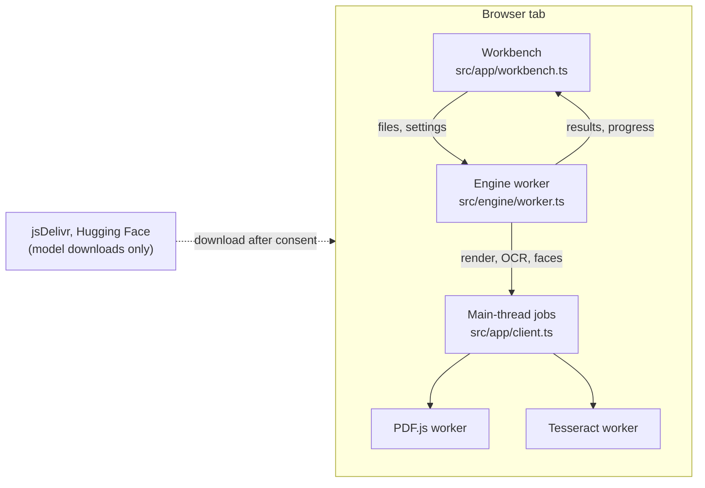

# Architecture

Lathe is a static Astro site with one crawlable page per tool. There is no server code. Each page loads a small script, and the heavy engines download only when a tool first needs them.

## The registry

[`src/data/tools.ts`](../src/data/tools.ts) describes every tool: its name, accepted files, controls and copy. These all read from it:

- the tool pages and their JSON-LD
- the sitemap, `llms.txt` and the command palette
- the settings panel, which is built from the `controls` array
- the test suite, which runs each entry against a real fixture

A conversion page such as `heic-to-jpg` is a registry entry with `run: "convert-image"` and a preset format.

## Running a tool

1. The workbench posts `Blob` references to the worker, so large files are not copied.
2. The worker finds the engine function with the tool's id in `image.ts` or `pdf.ts`.
3. The engine returns files, text or swatches. Buffers are transferred back, not cloned.

Tools marked `live` also run on every setting change. In preview mode, images are capped at 1400 px and the last six decodes are cached, so sliders do not decode the file again.

## Why some jobs run on the main thread

PDF.js manages its own worker and draws to a DOM canvas, and Tesseract and MediaPipe load the same way. The engine worker asks the page to do these jobs over a small message channel and receives an `ImageBitmap` or text back. The page stays responsive because the slow part of each job runs in that library's worker.

MediaPipe is the exception: its detection call runs on the main thread, so face blur can briefly hold up the page.

## HEIC export

Shipping an HEVC encoder would bring in x265's GPL licence and HEVC patent questions. Lathe asks the browser's own encoder for a single keyframe through WebCodecs, then [`src/engine/heif.ts`](../src/engine/heif.ts) writes the HEIF boxes around it. The tests open the output with macOS ImageIO, an independent decoder, and compare pixels.

## AI models

| Task | With WebGPU | Without WebGPU |
|---|---|---|
| Background removal | BiRefNet Lite, 1024 px, 115 MB | MODNet, 7 MB, built for portraits |
| Upscaling | Swin2SR x2, 54 MB | Swin2SR x2 quantised, 22 MB |

Hugging Face models are pinned to a commit in [`src/engine/ai.ts`](../src/engine/ai.ts). The ONNX Runtime binary is 26 MB, over Cloudflare's 25 MiB limit per file, so it loads from jsDelivr at the version in `package-lock.json`. Its small loader is served from this site, because a cross-origin loader would need a `blob:` script that the CSP forbids.
